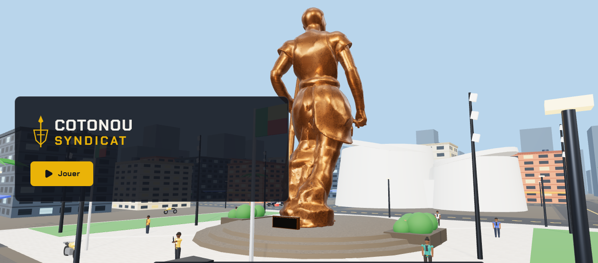

# Cotonou Syndicat



Jeu d'action 3D en monde ouvert se déroulant à Cotonou (Bénin), autour de l'Esplanade du Monument Amazone, du Boulevard de la Marina et du Tribunal de Cotonou. Développé avec Three.js, React, TypeScript et Tailwind CSS, avec une version Android WebView autonome embarquant tous les assets.

## Aperçu des fonctionnalités

- **Monde ouvert 3D** : Reproduction stylisée de Cotonou avec le Monument Amazone (`public/white_mesh.glb`), axes routiers, trafic et piétons.
- **Ambiance sonore officielle** : Lecture automatique de l'hymne national du Bénin (*L'Aube Nouvelle*) sur l'écran titre, interrompue dès le début de la partie.
- **Missions & Systèmes de jeu** : 4 missions progressives (dont *L'Or de la Marina*), conduite de véhicules, vue poursuite / intérieure, économie en FCFA et indice de recherche policière.
- **Tribunal de Cotonou en 3D** : En cas d'arrestation, basculement dans la grande salle d'audience animée (juge à la barre, avocats, public et box de l'accusé) avec paiement de caution ou reprise de partie.
- **Support multi-plateforme** : Jouable sur navigateur (desktop & mobile) et compilable en APK Android hors-ligne.

## Prérequis & Installation

```bash
npm install
npm run dev
```

L'application démarre sur `http://localhost:3000`.

## Scripts disponibles

- `npm run dev` : Lance le serveur de développement Vite sur le port 3000.
- `npm run build` : Compile le bundle web de production dans `dist/`.
- `npm run lint` : Vérifie le typage TypeScript (`tsc --noEmit`).
- `npm run sync:android` : Génère le build web en chemins relatifs et copie les assets HTML/JS/CSS/3D/audio dans `android/app/src/main/assets/`.
- `npm run build:apk` : Exécute la synchronisation des assets puis compile l'APK Android debug (`build/CotonouSyndicat-debug.apk`).
- `bash scripts/build-apk.sh --release` : Compile l'APK Android release (`build/CotonouSyndicat-release.apk`).

## Structure Android WebView

Le projet `android/` utilise `androidx.webkit.WebViewAssetLoader` (`https://appassets.androidplatform.net/index.html`) pour charger l'ensemble du jeu 3D (modules ES, modèles `.glb`, audio `.mp3`/`.ogg`) directement depuis les assets embarqués dans l'APK, sans erreur CORS ni dépendance réseau.

## CI/CD & Workflows GitHub Actions

- **GitHub Pages (`.github/workflows/deploy.yml`)** : Compile l'application web, ajuste automatiquement les URLs SEO (`sitemap.xml`, `robots.txt`, `llms.txt`, balises OpenGraph/Twitter) et déploie sur GitHub Pages.
- **Build APK Android (`.github/workflows/build-apk.yml`)** : Installe Node 22, Java 17, Android SDK 35 et Gradle 8.9 pour générer l'artefact `CotonouSyndicat-APK` (et publier une release sur les tags `v*`).

## SEO, Réseaux Sociaux & Indexation IA

- **Aperçu social (OpenGraph & Twitter Cards)** : Configuré dans `index.html` avec l'image `assets/aistudio/image_af82a75e.png` et les données structurées Schema.org (`VideoGame`).
- **Indexation** : `public/robots.txt`, `public/sitemap.xml` et `public/llms.txt` sont inclus dans le build web final.
